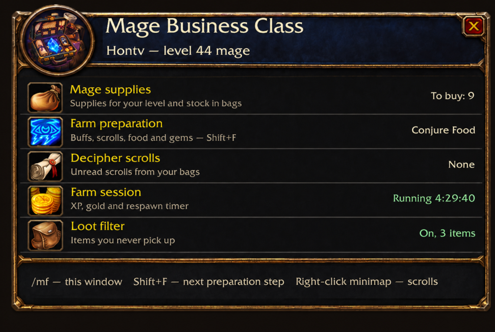

# Mage Business Class

A farming and preparation kit for mages in WoW: Forever. Formerly Mage Forever. Open it with `/mf` or the mana crystal on the minimap.

The home window lists every section with its live state: what is left to buy, your next preparation step, unread scrolls, the running farm session and the loot filter.

**Loot filter.** Drag an item into the "Never loot" list and it stays on the corpse from then on. The "What dropped" list shows everything you have looted, with vendor prices and the mob it came from. You can also skip all grey items. Hold Shift to loot by hand, and undo any change for 15 seconds. Open it from the home window or with `/mfloot`.

**Shopping.** Set a target for each supply. At the auction house, see what is missing from your bags and buy it with one button that shows the amount and the price. If the top rank is too expensive, compare the unit price of each rank and pick a lower one.

**Farm preparation.** Open `/mfbuff` to check food, water, your mana gem, armor and class buffs. Press **Auto Buff**, or Shift+F, for the next step. Water is offered with food when your mana runs low.

**Scrolls.** Open `/mfscroll` to see which scrolls in your bags you can decipher, and read them one press at a time.

**Farm sessions.** Open `/mf farm` to start or finish a session: profit, wallet, XP gained, hourly rates and the observed respawn time of a tracked enemy.

**Income per hour.** A small panel above the chat shows XP, gold and looted items per hour over your last 60 minutes of play, with an XP bar and the time left to the next level. Turn it on or off in the Farm window.

**World map zoom.** Scroll the mouse wheel over the world map to zoom toward the cursor, and drag to move around.

English and Russian.

## Installation

Download the latest `MageBusinessClass-<version>.zip` from [Releases](https://github.com/localhost1989/MageForever/releases/latest) and extract its `MageSupplyForever` folder into your WoW: Forever client's `Interface/AddOns` directory. Keep the existing folder name when updating.

Also on [CurseForge](https://www.curseforge.com/wow/addons/mage-business-class) and [Wago](https://addons.wago.io/addons/mage-forever).
