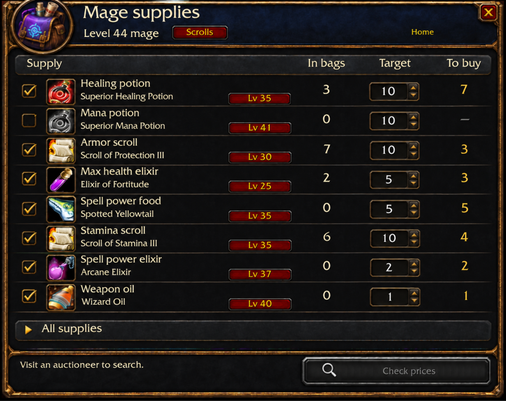

# Mage Business Class

Everything a farming mage does between pulls, on one key and a few windows. Made for WoW: Forever. Open it with `/mf` or the mana crystal on the minimap. Formerly Mage Forever.

**Stop deleting junk by hand.** Profession quest scrolls, intercepted crates that no vendor will buy, and other junk keep landing in your bags, and each one has to be dragged out and deleted. Tick "Leave artisan crates and orders" in the loot filter, or put any item on its "Never loot" list once. From then on the addon loots it last and throws it away for you with your next key press or click (the game allows deleting only on a press), and the corpse stops sparkling. Every item thrown away is noted in the chat. Rare and better items are never thrown away, and Shift lets you loot by hand. You can also skip all grey items. Open the filter with `/mfloot`.

**One key between pulls.** Press Shift+F. It casts your own buffs first and conjures water, then sits you down to drink until you are full. Once you are rested, the same key goes on with scrolls, oils, elixirs and buff food, and tops up your food and water last. Out of mana for water, it offers Evocation or your mana gem instead of a meal that brings no mana back.

**Consumables in one click.** Set how many of each supply you want to carry. At the auction house, the addon shows what is missing from your bags and buys it with one button that shows the amount and the price. If the top rank is too expensive, compare unit prices and drop a rank.

**Also inside**

- **Home window.** Every section with its live state: what is left to buy, your next preparation step, unread scrolls, the farm session and the loot filter.
- **Scrolls.** See which scrolls in your bags you can decipher and read them one press at a time (`/mfscroll`).
- **Farm sessions.** Profit, XP and hourly rates, plus the respawn time of a tracked enemy (`/mf farm`).
- **Income per hour.** A small panel above the chat with XP, gold and loot per hour and the time to your next level.
- **Drop log.** The loot filter's "What dropped" list shows recent loot with vendor prices and the mob it came from.
- **World map zoom.** Scroll the mouse wheel over the map to zoom toward the cursor, and drag to move.

English and Russian.

## Installation

Download the latest `MageBusinessClass-<version>.zip` from [Releases](https://github.com/localhost1989/MageForever/releases/latest) and extract its `MageSupplyForever` folder into your WoW: Forever client's `Interface/AddOns` directory. Keep the existing folder name when updating.

Also on [CurseForge](https://www.curseforge.com/wow/addons/mage-business-class) and [Wago](https://addons.wago.io/addons/mage-forever).
